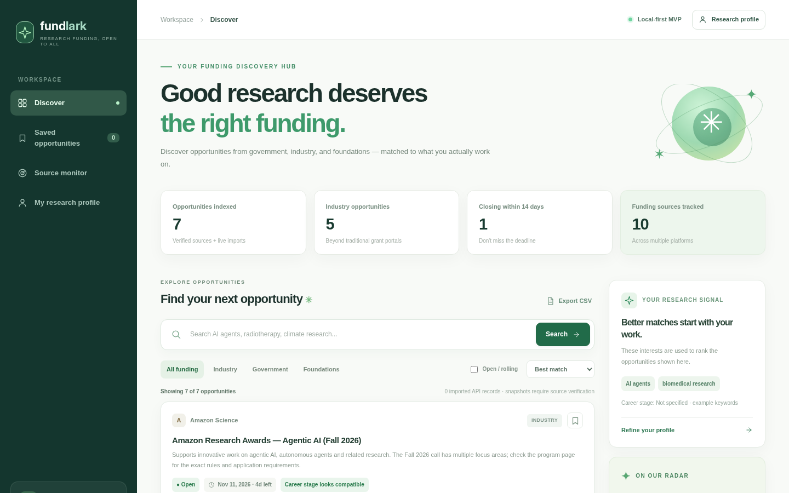

# Fundlark 🌱

**Funding discovery for early-career researchers, built in the open.**

Fundlark is a runnable local-first MVP for discovering research funding from **industry, government, foundations, institutions, and societies**. It combines a source-transparent funding catalog with CV keyword extraction, profile-aware ranking, simple career-stage eligibility hints, source-page change monitoring, and an optional live U.S. federal grant import.

> **This is a working prototype, not a verified live grant database.** The initial industry/foundation listings are dated snapshots (researched November 7, 2026). Always read the funder's official page before applying. The federal API can be queried live when you have internet access. The application does not claim to have scanned the entire web or to verify open applications automatically.

## Public webpage and shared discoveries

The [browser webpage](docs/demo/) accepts a sentence or comma-separated topics and
shows the words used for catalog matching. It matches funding against research topics,
career stage, memberships and institutions without a Python server. Profiles stay
in browser storage. Users can copy a personalized brief to their own AI assistant
for deeper live discovery. The basic copied request needs no skill installation;
the optional skill adds the contribution workflow. Users can save, copy and download
a local shortlist. Past rounds are opt-in, and source age and career-stage concerns
are visible on each card.

The optional [Cloudflare community service](services/community/) accepts public
funding records from agents when users enable sharing, queues them for maintainer
review, and makes approved records available to later visitors. Users do not need
GitHub accounts or contribution forms. Static-only hosting works without this
service and clearly shows sharing as unavailable. No paid AI API is included.

See [local preview, deployment, review and budget limits](docs/community-launch.md)
and the [simulated usability review and product priorities](docs/research/usability-review.md).
The service is implemented and tested locally; production needs the owner's
Cloudflare account and secrets before community sharing can be enabled.

## Use Fundlark with your own AI assistant

The standalone [Fundlark skill](skills/fundlark/SKILL.md) works through Codex, Claude Code, or another compatible agent. It uses available research context, a public funding snapshot when supplied, and live official sources to build a personalized shortlist. The web app and a central Fundlark server are optional. Users provide their own AI account and web tools; the optional Grants.gov helper uses Python's standard library and no API key.

The starter source registry is not a discipline whitelist. The skill should discover additional funders, societies and institutions from each user's actual context. The local webpage combines a finite public catalog with source-search routes; saving a membership does not automatically crawl every grant from that society. See [how to test society discovery](docs/testing-funding-discovery.md). Profile/CV suggestions and custom organizations extend the pickers without publishing personal information.

The maintainer can collect/review records locally, export public funding facts to GitHub, and publish the [static demo](docs/demo/) through GitHub Pages. Personal profiles, CVs and conversations are excluded from public exports. See [installation, local publishing and the demo workflow](docs/skill-distribution.md), and the [source review of popular skill projects](docs/research/skill-projects.md).



## Screens / features

- **Affiliation-aware discovery:** CV parsing suggests professional memberships and institutions with supporting lines for review. Confirmed affiliations route to society and internal-funding sources, including IEEE, ASTRO, AAPM and Stanford; other institutions receive discovery queries. Past education and publication mentions do not automatically establish membership or current affiliation.
- **Broader industry coverage:** 15 registered industry sources span computing, cloud credits, medical devices and pharmaceutical investigator-sponsored research. Program-directory entries marked `verify` are not confirmed open calls.

- **Discover:** search across all catalog records, filter by industry / government / foundation and by open status, sort by relevance or deadline.
- **Research profile:** upload a **PDF / DOCX / TXT CV** (up to 8 MB) to extract candidate research keywords, review the suggestions, and select career stage.
- **Explainable matching:** local keyword / phrase match and synonym expansion; explains preliminary career-stage compatibility. A relevance score **is not an application eligibility decision**.
- **Saved opportunities:** local browser-based shortlist.
- **Industry & foundation radar:** watch fixed official URLs for content changes, collect potential funding links into an **unreviewed review queue**, show source checks, flag changed pages for manual review. Honors `robots.txt`.
- **Live government data:** fetch open / forecasted Grants.gov opportunities without an API key, or use the enhanced Simpler.Grants.gov API by providing an optional API key.
- **CSV export:** download your indexed funding records.
- **Privacy-first:** uploaded CV bytes are processed in memory and not retained by the backend; extracted profile terms and saved records live in browser `localStorage` (not synchronized across devices).
- **Standalone skill + static preview:** users can keep personalization in their own AI environment, use public snapshots as a starting point, and verify current calls without a central Fundlark application server.

## Quick start

Python 3.11+:

```bash
cd Fundlark
python -m venv .venv
source .venv/bin/activate           # Windows: .venv\Scripts\activate
pip install -r requirements.txt
uvicorn app.main:app --reload --host 127.0.0.1 --port 8000
```

Open **http://127.0.0.1:8000**. API docs: **http://127.0.0.1:8000/docs**.

**Docker alternative:**

```bash
docker compose up --build
```

Then open http://127.0.0.1:8000.

No LLM, paid API or account is required for basic features. Network access is required to use federal APIs and official-page monitors.

## Import live funding opportunities

Go to **Source monitor → Sync federal opportunities** and enter up to five comma-separated topics (e.g. `AI, medical research, early career`). The application calls the public Grants.gov `POST https://api.grants.gov/v1/api/search2` endpoint and merges the results by official source ID. Searches include only `posted` and `forecasted` opportunities; the result listing preserves the distinction. Imported abstracts and amounts may be incomplete; the official listing takes precedence.

Optional: use the authenticated Simpler.Grants.gov API by setting `SIMPLER_GRANTS_API_KEY` in your environment (see `.env.example`). Its `POST /v1/opportunities/search` endpoint is documented at https://simpler.grants.gov/developers. The implementation is minimal; API schemas may change.

The import does **not** run automatically on first launch and will never silently report a failed API fetch as successful. A successful import is stored locally in `data/fundlark.sqlite3`.

To schedule periodic syncing on your own machine/server (for example through cron), you can call:

```bash
curl -X POST http://127.0.0.1:8000/api/sync/federal \
  -H 'Content-Type: application/json' \
  -d '{"queries":["AI", "biomedical research", "early career"]}'
```

**Security:** Do not expose write/sync routes directly to the public internet without authentication and rate limiting. The prototype is intentionally single-instance/local-first. For a production multi-user deployment add login, an administration boundary, quotas and abuse controls.

## Source monitoring: what it does and doesn't do

The source registry is in `app/sources.json`. It includes government API entries and official program pages for Amazon, OpenAI, NVIDIA, Google Research, Wellcome, and the Chan Zuckerberg Initiative. The initial curated opportunity catalog is in `app/catalog.json`.

- The monitoring job fetches only **preconfigured, fixed official URLs**, checks robots.txt, removes basic layout elements, and hashes the readable page text.
- Subsequent page-content changes are flagged for review. Links whose labels suggest possible calls/awards are captured in a separate unreviewed queue; they **do not automatically create a new grant**, update eligibility, or claim that a program is open.
- The first check establishes a baseline (it is not a manual verification). Pages blocked by robots.txt or requiring JavaScript may not be monitorable.
- Readable funding text and candidate link destinations are retained in the latest **20 distinct snapshots per source**. The dashboard's **Review changes** control shows a text diff and records a review note against the snapshot hash. A concurrent page change rejects an outdated review. Pending review flags survive unchanged checks and temporary failures.
- Page reviews acknowledge a source change; they **do not verify opportunities** or clear opportunity-level review warnings. Curated records still need a reviewed catalog update. Candidate links can be **shortlisted** or **dismissed**, with an audit history; neither action publishes a grant.
- Requests use bounded responses (3 MB), at most two retries for transient failures, and conditional requests when the server supplies validators. Each redirect target must remain on a registered official HTTPS host and pass its own robots check. For a legitimate redirect to a different host, explicitly add that host to the source's `redirect_hosts` list after reviewing it.
- A catalog entry becomes **stale** after 30 days since its last curated/API verification; its deadline-based closed state is also computed dynamically.
- To add verified industry opportunities, curate `app/catalog.json` with official URLs, as-of dates, status, tags and preliminary eligibility fields. Restart the app to insert new IDs (existing records aren't overwritten automatically).

## Project structure

```
app/
  main.py         FastAPI routes, transient CV parsing, CSV export
  connectors.py   Grants.gov & optional Simpler.Grants.gov adapters
  monitoring.py   Robots-aware requests, bounded retries, page snapshots and change detection
  matching.py     Explainable cost-free keyword matching and eligibility hints
  storage.py      SQLite catalog, retained source snapshots, review audit trails and sync logs
  catalog.json    Dated, human-curated opportunity snapshots
  sources.json    Fixed, official data-source registry
  static/         Responsive dashboard (plain HTML/CSS/JS)
tests/            Backend tests
Dockerfile / compose.yaml
```

## Test

GitHub Actions runs the Python tests and JavaScript syntax validation on pushes to `main` and on pull requests.


```bash
pip install pytest
pytest -q
```

## Renaming from OpenGrant MVP

The project is now **Fundlark**. Existing browsers can import `opengrant.profile` and `opengrant.saved` if the corresponding new Fundlark keys do not yet exist. The backend also detects an existing `data/opengrant.sqlite3` database if there is no `data/fundlark.sqlite3`. Set `FUNDLARK_DB` explicitly to choose your own database path. No other features have been changed by the rename.

## Privacy and limitations

- No profile server-side storage or third-party AI processing. The CV uploader does not OCR scanned PDFs.
- **No authentication**: intended for running locally or behind a trusted private gateway. Never publicly expose the administration/sync endpoints without access controls.
- CV file processing and document libraries should be kept updated; for untrusted, internet-scale deployment, add MIME sniffing, malware screening and sandboxed document parsers.
- Browser localStorage is not appropriate for sensitive personal data in a shared browser; clear site data to remove it.
- Federal opportunities may require eligible institutions or organizations even when the research topic is a close match. Stage heuristics are not legal eligibility determinations.
- Source watchers compare snapshots only. They do not give guaranteed current status, detect all new programs, or substitute for reviewing the official funding call.
- Several curated examples include **closed grants** intentionally, to demonstrate the value of monitoring recurring industry programs. Funding amounts are omitted unless grounded in official program descriptions.
- On production deployment use HTTPS, credentials, CSP, request throttling, a persistent worker for scheduled jobs, structured logging, and a review/approval queue for new grant claims.

## Next milestones

1. Deploy the browser matching and reviewed community contribution service; measure real coverage and usage.
2. Production collection scheduler with robust per-source adapters, structured diffing, retries, and reviewer queue.
3. Multi-user accounts / organizations, email alerts, personal saved searches and deadline tracking.
4. Optional local sentence-embedding model for semantic retrieval, plus a user-configurable LLM *only* for explanations.
5. International funder connectors, e.g. EU Funding & Tenders, further foundations and industry research calls.

## Verified official technical sources

- Grants.gov Search2: https://grants.gov/api/common/search2
- Simpler.Grants.gov API: https://simpler.grants.gov/developers
- Amazon Research Awards: https://www.amazon.science/research-awards/call-for-proposals
- OpenAI Researcher Access: https://openai.com/form/researcher-access-program/
- NVIDIA Academic Grant Program: https://www.nvidia.com/en-us/industries/higher-education-research/academic-grant-program/
- Google Academic Research Awards: https://research.google/programs-and-events/google-academic-research-awards/
- Wellcome Early-Career Awards: https://wellcome.org/research-funding/schemes/wellcome-early-career-awards

## License

MIT — see `LICENSE`.

## Periodic data refresh (optional)

Run the collector from cron or your own scheduler. For example, the following user crontab entry (replace the path) refreshes federal opportunities at 06:00 each day and checks industry/foundation pages at 08:00 on weekdays:

```cron
0 6 * * * cd /path/to/fundlark && .venv/bin/python -m app.jobs --federal >> data/sync.log 2>&1
0 8 * * 1-5 cd /path/to/fundlark && .venv/bin/python -m app.jobs --monitor >> data/monitor.log 2>&1
```

This is **opt-in** and runs only on your own host. Do not use aggressive crawl schedules. Source content changes remain in the unreviewed queue until human verification.

Collection jobs exit with status **1** when a federal query fails or a page check fails/is skipped, so a scheduler can detect incomplete coverage. Successful results are still retained. A valid empty federal response is reported as a successful search with no matches; malformed responses are errors. Each topic currently imports at most 30 results from its first page, so this is a discovery sample rather than an exhaustive federal index. Records absent from a later search are preserved and become stale; absence is not evidence that a grant closed.

The optional Simpler adapter reads its structured `summary` fields. Where it provides `legacy_opportunity_id`, the record uses the same `grantsgov:` ID as the public API to avoid duplicates when switching providers. Original provider URLs, import origin and observation timestamps remain visible.

## Review API (local administration)

- `GET /api/sources/{source_id}/changes` returns the latest two snapshot metadata records, their bounded text diff and recent review notes.
- `POST /api/sources/{source_id}/review` accepts `{"content_hash":"<latest SHA-256>","note":"What you checked"}`. An outdated hash returns HTTP 409.
- `GET /api/candidates?status=unreviewed|shortlisted|dismissed|all` lists up to 50 links (default: `unreviewed`).
- `PATCH /api/candidates/{id}` accepts `{"status":"shortlisted","note":"Optional review note"}`. Allowed states are `unreviewed`, `shortlisted` and `dismissed`.

Existing MVP databases migrate additively on startup. Back up `data/fundlark.sqlite3` before upgrading a working installation. Source snapshot content and review notes are local application data; avoid putting personal information in review notes.

### Browse the field and conference directory

Open the static demo and choose **Explore fields & conferences**. It includes 119 society
and conference routes across 114 field/topic labels, plus a separate source-backed
seed of travel awards, scholarships and small grants. Directory entries are not open
calls. See [coverage and launch gates](docs/research/launch-coverage.md) for the
generator, verification process and remaining gaps.

For periodic catalog upkeep, use the separate [Fundlark maintainer skill](skills/fundlark-maintainer/SKILL.md). It can prepare a paginated Grants.gov refresh and a reviewable catalog update. The public site reads a static snapshot; society, foundation, industry, and institution calls still need source review.

See the [low-cost catalog growth workflow](docs/catalog-growth.md) for society, industry, and university funding.
