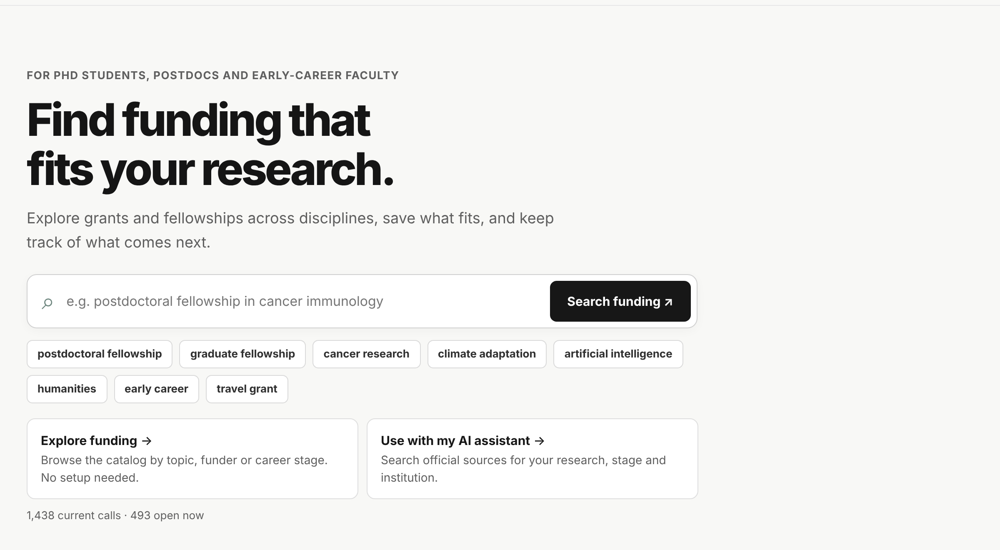
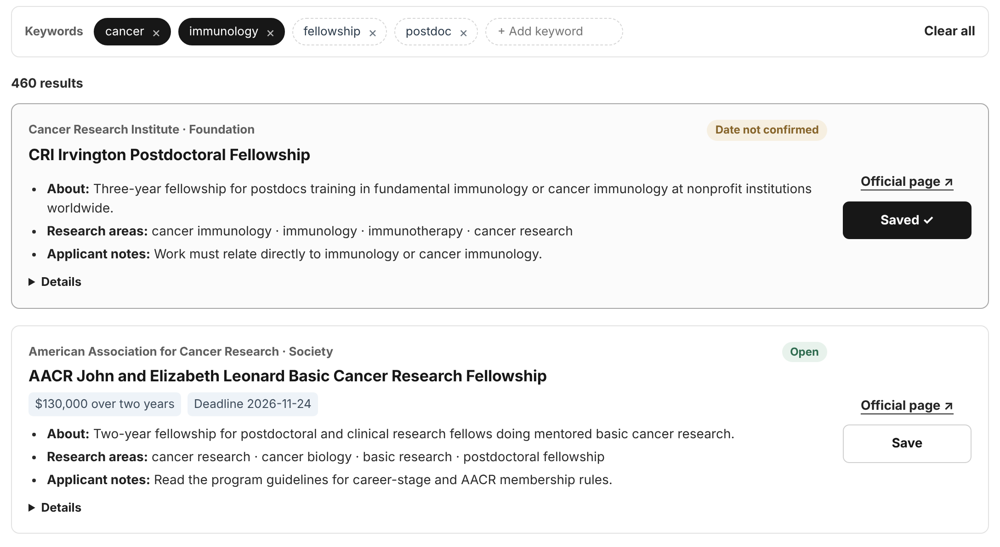

<p align="center">
  
</p>
<h1 align="center">Fundlark</h1>
<h3 align="center">Find funding that fits your research.</h3>
<p align="center">For PhD students, postdocs and early-career faculty. Free and open source.</p>

<p align="center">
  <a href="https://dryang21.github.io/Fundlark/"><strong>Open the website</strong></a> ·
  <a href="#for-you"><strong>Use it with your AI assistant</strong></a> ·
  <a href="#for-ai-agents"><strong>For AI agents</strong></a> ·
  <a href="#faq"><strong>FAQ</strong></a> ·
  <a href="https://github.com/dryang21/Fundlark/issues/new/choose"><strong>Suggest a funding source</strong></a>
</p>

<p align="center">
  <a href="LICENSE"></a>
  <a href="https://github.com/dryang21/Fundlark/actions/workflows/tests.yml"></a>
  
</p>

<p align="center">
  <a href="https://dryang21.github.io/Fundlark/"></a>
</p>

Finding funding is hard when you are starting out. Calls are scattered across government agencies, foundations, societies and your own university, and every one has its own deadline and fine print. Fundlark gives you one place to search, a tracker for what you plan to apply to, and an AI-assistant skill that does the digging for your specific situation.

## What you get

Ask your AI assistant:

> Use Fundlark. I'm a postdoc in cancer immunology at a U.S. university. Find fellowships I can apply for myself and check the deadlines on the official pages.

It comes back with a short, checked list. An abbreviated example from November 2026:

> **Top priorities**
>
> 1. **[HHMI Hanna H. Gray Fellows Program](https://www.hhmi.org/programs/hanna-h-gray-fellows)** — *Apply yourself* · closes 15 Dec 2026, 5 PM ET
>    Postdocs with up to seven years of experience who plan to start a faculty job; check the HHMI-eligible institution rule.
> 2. **[Damon Runyon Quantitative Biology Fellowship](https://www.damonrunyon.org/for-scientists/application-guidelines/quantitative/forms)** — *Apply yourself* · closes 1 Dec 2026, 4 PM ET
>    Three-year fellowship for computational and quantitative scientists; degree and lab-start date windows apply.
> 3. **[AACR Leonard Basic Cancer Research Fellowship](https://www.aacr.org/grants/aacr-john-and-elizabeth-leonard-basic-cancer-research-fellowship/)** — *Apply yourself* · letter of intent 24 Nov 2026
>    $130,000 over two years; full applications by invitation. Check AACR membership rules.
>
> **Date to confirm:** [CRI Irvington Postdoctoral Fellowship](https://www.cancerresearch.org/cri-irvington-postdoctoral-fellowship) — the official page could not be reached, so the next deadline is unconfirmed.

Every lead links to the funder's own page, says whether you can apply yourself or need an advisor or institution, and separates "relevant to your research" from "you are eligible".

## Three ways to use it

| | Best for | What to do |
| --- | --- | --- |
| **🔎 Search the website** | Browsing what's out there, no setup | [Open the website](https://dryang21.github.io/Fundlark/) and type a topic, a funder or a sentence about your work. Edit the keyword tags, filter by field or career stage, and save calls to your tracker. |
| **💬 Ask your AI assistant** | A personalized search in any assistant with web browsing (ChatGPT, Claude, Gemini…) | [Tell it to use Fundlark](#for-you), or build the request on the website under **Use with AI** and paste it. |
| **🧩 Install the skill** | Repeat use in Claude Code, Codex or Cursor | Ask your assistant to install it, or run one command. It then follows Fundlark's checking workflow whenever you ask about funding. |

<p align="center">
  
</p>

## Use it with your AI assistant

### For you

Just tell your assistant to use Fundlark. No terminal needed.

**Chat assistants with web browsing** (ChatGPT, Claude, Gemini…): paste this, filling in the brackets.

```text
Read the Fundlark instructions at
https://raw.githubusercontent.com/dryang21/Fundlark/main/skills/fundlark/SKILL.md
and follow them to find funding for me. I'm a [career stage] in [field] at [institution] in [country].
My project: [one or two sentences].
```

**Claude Code, Codex or Cursor:** ask once, and it's installed for future sessions.

```text
Install the Fundlark skill from github.com/dryang21/Fundlark, then use it to find funding for my project.
```

More things to ask:

- *"Use Fundlark to find funding for the project we're discussing. Separate what I can apply for myself from what needs my advisor."*
- *"I'm a PhD student in sociology at the University of Toronto. Use Fundlark to find dissertation fellowships and travel grants due in the next six months."*
- *"Use Fundlark to refresh my fundlark-library.json and tell me what's new, changed or expired."*

<details>
<summary>Prefer to install it yourself?</summary>

From the folder you open in your assistant (Node.js 22.20 or later):

```sh
npx skills add dryang21/Fundlark --skill fundlark
```

Add `-g` to install it for all your projects. No terminal? [Download the ZIP](https://dryang21.github.io/Fundlark/Fundlark-skill.zip) and follow the [manual setup](docs/skill-distribution.md#manual-install-from-zip).
</details>

### For AI agents

If a user asks you to use Fundlark:

1. **Install the skill** if you can run commands and the user agrees:
   `npx skills add dryang21/Fundlark --skill fundlark` (use `-a claude-code` or `-a codex` to pick the host, and `-g` for all projects). Then load the installed `fundlark` skill.
2. **Otherwise, read the instructions directly** from
   `https://raw.githubusercontent.com/dryang21/Fundlark/main/skills/fundlark/SKILL.md`
   and follow them. Resolve its `references/…` links against the same folder, for example
   `https://raw.githubusercontent.com/dryang21/Fundlark/main/skills/fundlark/references/verification.md`.
3. **Optional catalog index:** `docs/demo/data.json` and `docs/demo/fellowships.json` in this repository (raw URLs as above). They are starting points; confirm every call on the funder's official page.
4. **Ask only for what changes the result** (career stage, country, field). Do not require a CV. Send only public topic keywords to search services.
5. **Return** three to five priorities with official links, deadlines and who can apply, grouped into: apply yourself · needs an advisor or institution · details to confirm · future rounds. Offer to save a `fundlark-library.json` the user can import at https://dryang21.github.io/Fundlark/ → **My tracker → Import library** (format: `skills/fundlark/references/personal-library.md`).

**What Fundlark adds to a plain prompt**

- Starts students and postdocs with fellowships that pay the person, then travel and small grants.
- Looks beyond government databases: your field's societies, your university's internal and limited-submission rounds, foundations and industry programs.
- Checks deadlines, status and eligibility on the official call, and reports conflicting dates instead of guessing.
- Writes a `fundlark-library.json` that you can import into the website's tracker. Re-importing keeps your notes and progress.

[Skill details](skills/fundlark/SKILL.md) · [Install guide](docs/skill-distribution.md) · [Sample library](https://raw.githubusercontent.com/dryang21/Fundlark/main/evals/results/2026-11-14-skill-search-sample.json)

## What's in the catalog

About **1,400 current calls** (around 500 open now), plus past rounds for reference, drawn from:

- U.S. federal grants (Grants.gov), UK Research and Innovation and EU Horizon Europe
- Early-career fellowships, checked by hand on each funder's page (HHMI, Damon Runyon, Jane Coffin Childs, Humboldt, NSF GRFP, Hertz and more)
- Society, foundation, industry and university programs
- A directory of 225 funder websites and 133 societies and conferences

**Honest limits.** The catalog is a starting point, not every grant in the world. Coverage is strongest for biomedical, engineering and computing in the U.S., UK and EU, and thinner for the humanities, arts and many countries. Dates come from each source and can change, so always confirm on the official call. The AI skill fills these gaps by searching live sources.

## Privacy

- The website has no accounts. Your tracker and request details stay in your browser.
- The public demo uses [Cloudflare Web Analytics](https://developers.cloudflare.com/web-analytics/about/) to count visits and see where visitors came from. The analytics script does not run on prefilled search links or URLs with query parameters. Fundlark does not send form inputs, saved grants, or tracker notes to analytics. Local copies do not run analytics.
- The website never sends your research description anywhere. It only goes into the text you choose to copy. The optional worldwide institution search sends just the name you type to the Research Organization Registry.
- The skill runs in your own AI assistant, under that provider's privacy terms. It sends only public topic keywords to funder search services, never your CV or conversation.

## FAQ

**Is it free?** Yes. The website, the skill and the code are free and MIT-licensed.

**Does Fundlark decide whether I'm eligible?** No. It shows each call's stated rules, and the skill checks them against what you tell it, but the funder's official guidelines are the final word.

**My field or country has few results. What can I do?** Use the AI skill or the paste-a-request option, which search live sources. And please [suggest the funding sources you know](https://github.com/dryang21/Fundlark/issues/new/choose) so the catalog improves for everyone.

**Can it write my application?** No. Fundlark helps you find and track opportunities; it doesn't draft proposals or submit anything.

## Contributing

Suggestions for funding sources are the most helpful contribution: [open an issue](https://github.com/dryang21/Fundlark/issues/new/choose) with the official link. For code, see [CONTRIBUTING.md](CONTRIBUTING.md).

<details>
<summary><strong>Run the website locally</strong></summary>

```sh
python3 scripts/package_skill.py
python3 -m http.server 8059 --bind 127.0.0.1 --directory docs/demo
```

Open [localhost:8059](http://127.0.0.1:8059/). No database, login or paid API needed. Run the tests with `npm test` and `python3 -m pytest`. The [catalog maintenance guide](docs/catalog-growth.md) covers adding and verifying sources, and the [quality audit](docs/recommendation-quality.md) tracks coverage.
</details>

---

<p align="center"><em>Built for researchers, because finding funding is already enough work.</em><br>MIT licensed · <a href="CHANGELOG.md">Changelog</a></p>
