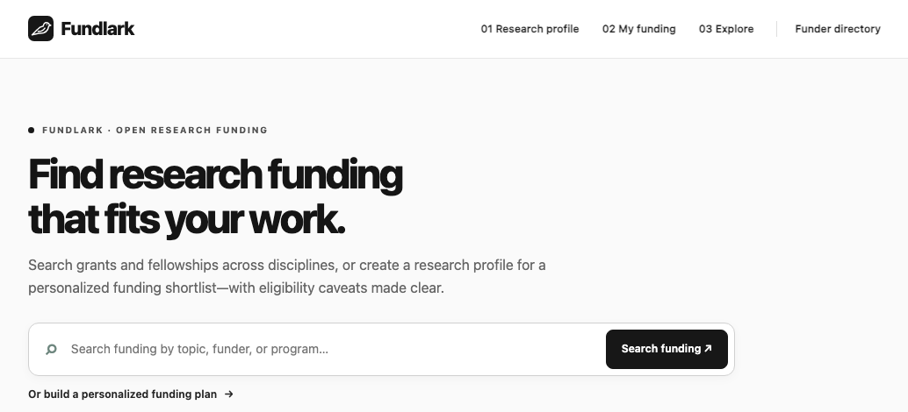

# Fundlark

**Find research funding and keep track of what to apply for.**

[Open the web demo](https://dryang21.github.io/Fundlark/) · [Install the AI skill](#install-the-fundlark-skill) · [Run locally](#run-locally)

Fundlark is free, open-source software for researchers, with two parts:

- **The website** is a broad search. Type a topic, a funder or a sentence about your work and browse grants and fellowships across every field, then save the ones you like to a tracker. It shows each call's stated rules but does not decide whether *you* can apply.
- **The Fundlark skill** is for a personalized shortlist. Your own AI assistant searches live official sources for your project, career stage, institution and memberships, checks deadlines and eligibility, and writes a library file the tracker can import.

## Start here

| I want to… | What to do |
| --- | --- |
| **Browse what's out there** | [Open the website](https://dryang21.github.io/Fundlark/) and search in plain words, e.g. *postdoctoral fellowship cancer immunology* or *graduate fellowship*. Filter by field, source, stage or availability. |
| **Get a shortlist made for me** | [Install the Fundlark skill](docs/skill-distribution.md#install-the-skill) in Codex or Claude Code. Ask it to check official calls for your topic, career stage, institution and society memberships. No skill? The website's **Personalize with AI** panel copies a ready-made request for any assistant with web browsing. |
| **Track opportunities I’ve found** | Ask the skill to write a `fundlark-library.json`. On the website, open **My tracker → Import funding library**. Reimport a refreshed library without losing your notes or application progress. |

The demo is a snapshot, not a comprehensive live database. Past rounds are hidden by default. Read the official call before applying. Your tracker and request details stay in browser storage; download a private backup if you want to move them or restore them later. The optional skill uses the tools and account of your chosen AI assistant.



## Install the Fundlark skill

In a terminal, run this from the folder you open in Codex or Claude Code (Node.js 22.20 or later):

```sh
npx skills add dryang21/Fundlark --skill fundlark
```

Select your assistant if prompted, then open a new session in that folder. Add `-g` to install for your user account across projects. Prefer no terminal? [Download the ZIP](https://dryang21.github.io/Fundlark/Fundlark-skill.zip) and follow the [manual setup steps](docs/skill-distribution.md#manual-install-from-zip).

Try asking:

> Use Fundlark to find funding for the project we’re discussing. Check current deadlines and eligibility on official sites. Separate opportunities I can apply for directly from ones that need an advisor or institutional lead. Save the results as `fundlark-library.json` for the tracker.

[Skill instructions and installation](docs/skill-distribution.md) · [Sample library to import](https://raw.githubusercontent.com/dryang21/Fundlark/main/evals/results/2026-11-14-skill-search-sample.json)

## Run locally

From a clone or extracted copy of this repository, run:

```sh
python3 scripts/package_skill.py
python3 -m http.server 8059 --bind 127.0.0.1 --directory docs/demo
```

Open [localhost:8059](http://127.0.0.1:8059/). The browser demo does not need a database, a login, or a paid API. The [catalog maintenance guide](docs/catalog-growth.md) covers bulk sources, verification and local exports. See the [recommendation quality audit](docs/recommendation-quality.md) for shortlist coverage and release goals.

[Report a problem or suggest a funding source](https://github.com/dryang21/Fundlark/issues/new/choose) · [Contributing](CONTRIBUTING.md) · [MIT license](LICENSE)
